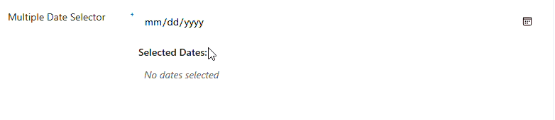

# 🌟 Multi-Date Selector PCF Control

An elegant and responsive multi-date selector for Dynamics 365 / Model-Driven Apps.
Lets users select multiple dates visually and stores the result in a single CRM field as a JSON array. Full dates use the browser's regional format; year-only mode stores years.

## ✨ Features
### Feature	Description
📅 Multi-date selection	Select/deselect dates from the calendar UI
🔄 Saves selected dates to the underlying field
🧩 Universal	Works with Text / Multi-Line Text fields
📱 Responsive	Fit inside forms and side dialogs
## Preview
</img>

## 📌 Use Cases

Availability scheduling

Project date milestones

Recurring visit planning

Attendance / event tagging

Multiple expiry reminders

## 🛠️ Installation

Import the solution.zip into your environment

Add the field (Text or Multi-line Text) to your form

Go to Field Properties → Controls

Add: Multi-Date Selector PCF

Enable for Web & Mobile

Publish all settings

Selected dates are stored as a JSON array. Full-date entries follow the browser's regional format (the example below is en-US); year-only mode stores year strings:

`["1/5/2025","1/20/2025","2/1/2025"]`

`["2025","2026"]`
